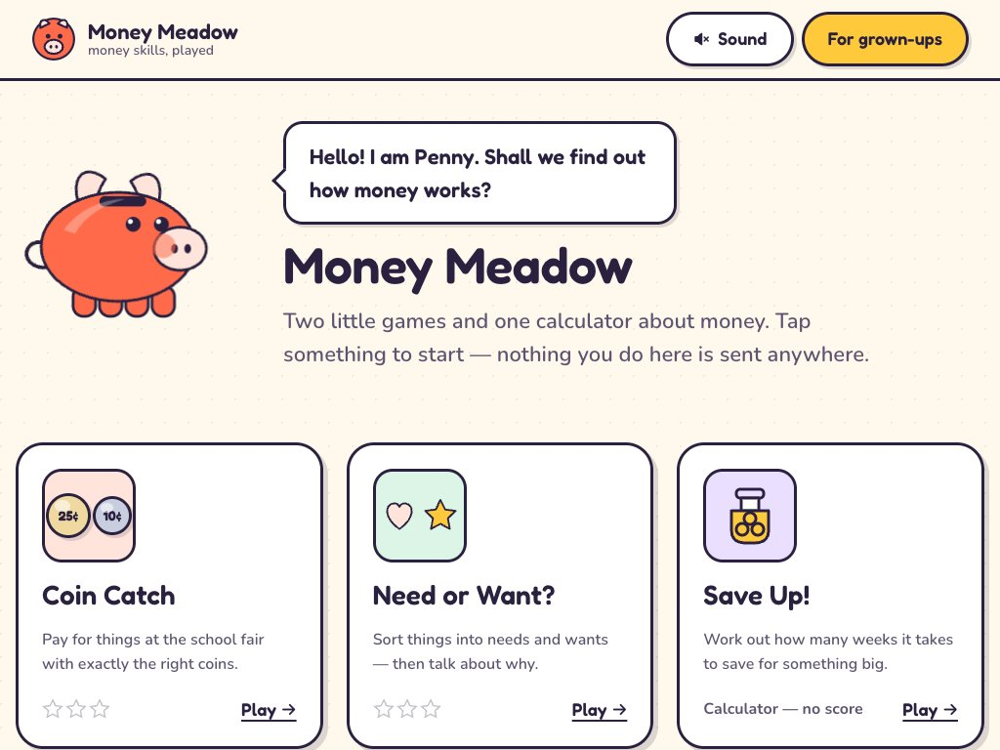
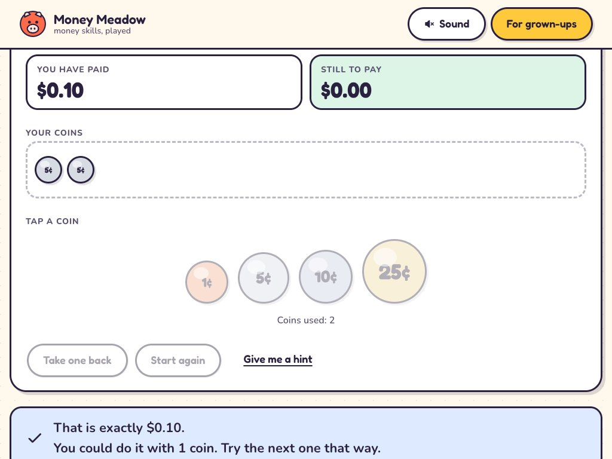
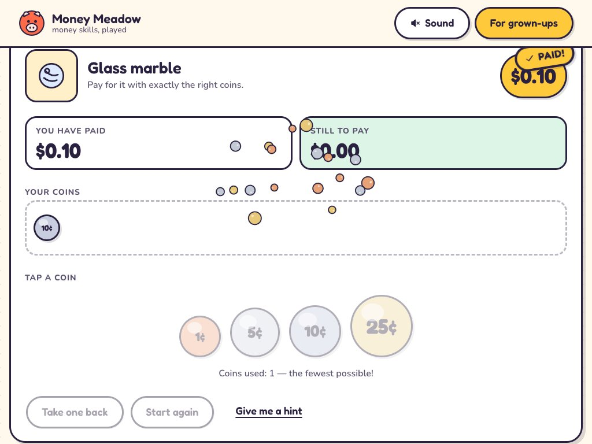
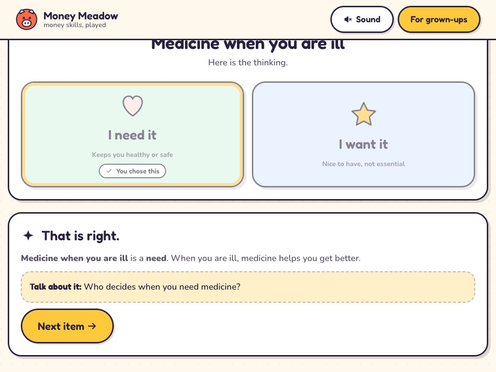
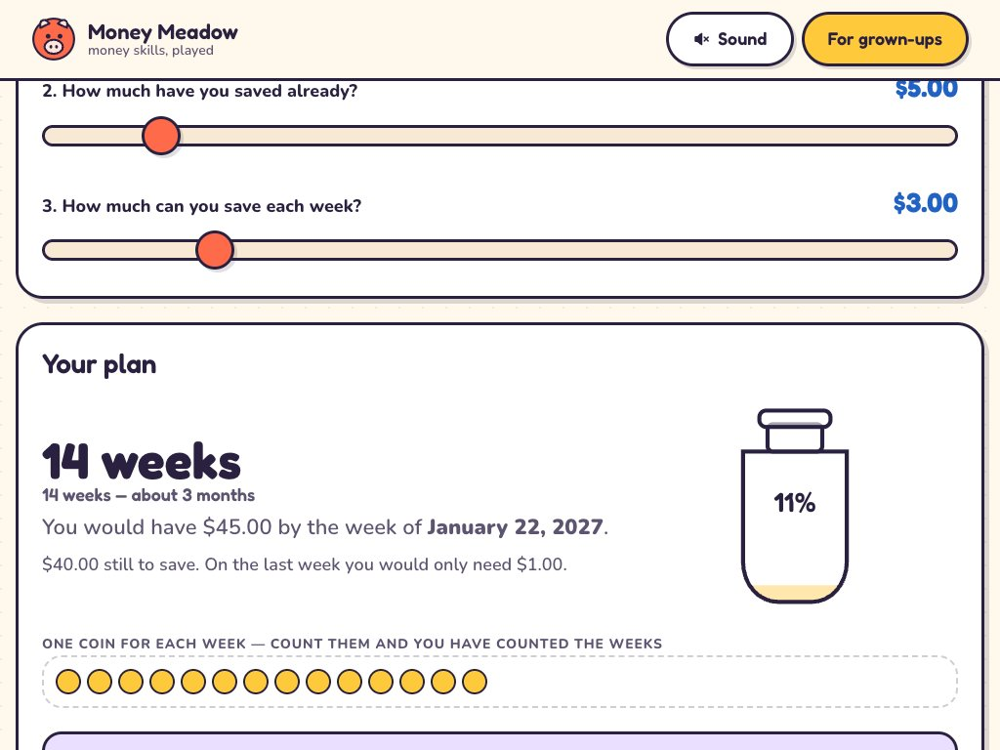
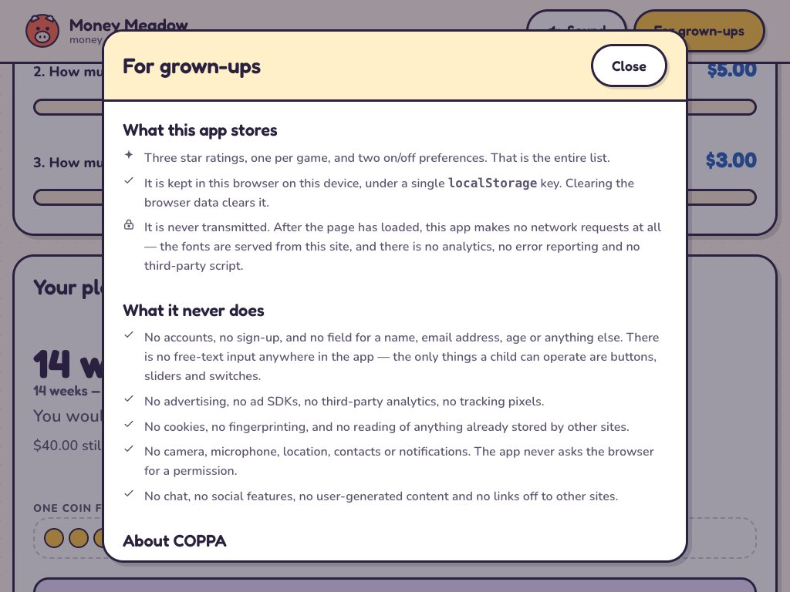

# Money Meadow

**Two mini-games and one calculator that teach children how money works.**
Tablet-first, keyboard playable, screen-reader playable, and built so that nothing a child does leaves the device.

**Live, playable on a tablet: <https://money-meadow.vercel.app>**

<p align="center">
  
</p>

<p align="center">
  
  
</p>

<p align="center">
  
  
</p>

<p align="center">
  
</p>

---

## The three things

| | What the child does | What it teaches |
|---|---|---|
| **Coin Catch** | Pays for items at a school-fair stall using exactly the right coins | Coin values, adding to a target, and finding the *fewest* coins for an amount |
| **Need or Want?** | Sorts ten everyday things into two bins, then reads why | The difference between a need and a want — and a question to ask a grown-up about each one |
| **Save Up!** | Sets a savings goal, a starting amount and a weekly rate | Turning a goal into a plan: how many weeks, what date, and what saving a bit more is worth |

## How it maps to the brief

| The brief asked for | Where it is |
|---|---|
| Interactive educational website or game for kids | All three modules; the two games are scored, the calculator deliberately is not |
| JavaScript / TypeScript, React or similar | TypeScript throughout, React 19, Vite 8. `strict` plus `noUncheckedIndexedAccess` |
| HTML5 animation | Mascot keyframes, coin and jar transitions, confetti, screen transitions — all CSS. See [why not canvas](#why-the-animation-is-not-a-canvas) |
| Simple game logic | Pure, tested logic modules: coin arithmetic and optimal-change DP, round selection and scoring, savings-plan projection |
| Financial calculators | `savingsGoal/calc.ts` — integer cents, ceilinged whole weeks, a five-year horizon, and a "what if you saved more" projection |
| Illustration and animation | Every icon and the mascot are hand-authored SVG on one 64×64 grid. No image files, no icon library, no emoji |
| Portfolio of playful, kid-friendly design | Bright palette, sticker outlines, 56–108px touch targets, rounded display type |
| COPPA | Zero collection by construction, enforced by a test. See [the COPPA position](#the-coppa-position) |
| Accessibility standards | Targets WCAG 2.2 AA, with three separate checks in `pnpm verify`. See [accessibility](#accessibility) |
| Mobile / tablet-first | Designed at 768–1024px first; 1024×768 fits the home screen and each game without scrolling |

---

## Run it

```bash
pnpm install
pnpm dev          # http://localhost:5173
```

```bash
pnpm verify       # typecheck + contrast audit + 97 tests + build + network audit
```

It is a static site. `pnpm build` produces a `dist/` of about 380 kB uncompressed (85 kB gzipped JavaScript, 6 kB gzipped CSS, 109 kB of woff2), and it deploys to any static host with no server, no environment variables and no database.

---

## Verification

Four checks, and every one of them fails the build rather than printing a warning.

```
pnpm typecheck        TypeScript, strict, with noUncheckedIndexedAccess
pnpm check:contrast   37 colour pairs measured against WCAG 2.2, each with its own floor
pnpm test             88 unit tests over the money, storage and game logic
pnpm check:network    audits dist/ for any third-party URL, analytics or ad signature
```

**Contrast** (`scripts/check-contrast.mjs`) — the palette is not asserted to be accessible; it is measured. Every foreground/background pair the interface actually uses is listed with the ratio it needs (4.5:1 for normal text, 3:1 for large text, component boundaries and the focus indicator), and the script exits non-zero if any pair drops below it. The tightest margin currently in the palette is 3.01:1 against a 3:1 floor, on the boundary of the "need" bin.

**Network** (`scripts/check-no-network.mjs`) — the claim on the grown-ups panel is that nothing is fetched after load, so it is checked: no external URL survives into the bundle, no analytics or advertising library is present by name, no asset in `index.html` is remote, and the webfonts are bundled locally. It carries two documented exceptions — React embeds its own error-documentation address as a *printed* string, and `"doubleclick"` alone matches React's `onDoubleClick` event name — because loosening a rule for everything to accommodate two false positives is how these checks stop meaning anything.

**Accessibility** (`scripts/audit-a11y.mjs`) — builds a throwaway copy of `dist/` with axe-core injected, walks seven screens (home, the grown-ups dialog, each game in both its playing and answered state), and writes the results into the page. axe-core is a dev dependency and never reaches the shipped bundle.

Current result: **zero violations on all seven screens.** Two items remain as "needs review":

- `color-contrast` on a few elements, because the page background is a CSS dot gradient and axe declines to compute contrast over it. Those pairs are covered by the measured palette audit instead.
- `form-field-multiple-labels` on the sound switch, which has two `<label>`s pointing at one input — one carrying the visible word, one `aria-hidden` wrapping the switch graphic so the whole control is tappable. That is intentional.

---

## Decisions worth explaining

### Money is an integer number of cents, everywhere

There is no float money in this codebase and `assertCents` is the tripwire that keeps it that way. A children's money game that renders "you have $0.30000000000000004 left" is a broken money game, and the fix is a type discipline rather than a rounding patch at the edge.

`minCoinsToMake` uses bottom-up dynamic programming rather than the greedy "take the biggest coin that fits" approach. Greedy happens to be optimal for the four US denominations, but that is a property of those four numbers, not a general truth — add a 15¢ coin and greedy starts returning wrong answers. The test suite pins both facts: that the two agree on the current denominations, and that they disagree on a set where greedy loses.

### An overshoot is refused, not penalised

In Coin Catch, tapping a coin that would take the tray past the price does nothing except shake and explain. The tray therefore always holds an amount less than or equal to the price. Three things fall out of that one rule: the child can always see exactly how much is still owed, which is the actual lesson; a mistake costs nothing, so there is no undo-the-wrong-answer step; and the puzzle state can never become unsolvable.

### Why the animation is not a canvas

Canvas would be the obvious choice for a coin game and it is the wrong one here. Anything drawn into a canvas is invisible to a screen reader and unreachable by a keyboard, so a canvas game needs an entire second interface built alongside it. Keeping every visual as DOM and SVG — coins as buttons, confetti as spans, the mascot as inline SVG with CSS keyframes — means the game *is* the accessibility tree, and one global reduced-motion rule switches all of it off at once.

### The celebration is decoration, and behaves like it

Clearing a level in Coin Catch is worth a moment: the coins the child just spent burst upward out of the tray, a "PAID" sticker lands on the price tag, the running total bounces and the "still to pay" cell flashes to zero.

Every part of that is built to be removable. All of it is `aria-hidden` and carries no information of its own, because the same instant is already announced in a full sentence by the live region. Under reduced motion the burst is not rendered at all and the stamp simply appears — the confirmation is the text, and the text never depends on the animation. The pieces also sit at `opacity: 0` in their resting state, so if an engine ever drops the animation they vanish rather than freezing as a ring of stray circles.

Two things worth noting about how it is built rather than what it looks like. The burst is keyed by round index, so each level gets its own burst instead of reusing a component whose animation has already finished. And the coins reuse the same ink outline and specular highlight as the resting coins in the tray — a smaller, flatter shape read as dust rather than as coins, which is what the first attempt looked like.

### The calculator is not scored

Coin Catch and Need or Want? award stars. Save Up! has no score, no rating and no wrong answer, and the card says so. It is a calculator: the child sets a rate and the app tells them the truth about it. Putting stars on it would teach that the number is the answer to a test rather than the answer to a question.

Two details in it are deliberate. Zero is not a *slow* rate, it is *no* rate at all — dividing by a zero weekly saving yields `Infinity`, and `Infinity` rendered into a sentence is how a calculator tells a child something false, so it has its own state. And there is a horizon: past five years the calculator says so and points at the weekly rate, because a plan that finishes in 400 years is not a plan.

### Tapping, not dragging

Need or Want? uses two large buttons rather than drag-and-drop. Drag would need an entire parallel interaction to work with a keyboard or a switch, it demands the motor control to hold a drag steady, and on a tablet it fights the browser's own scroll gesture. Two buttons a child can hit with a thumb do the same job.

### The interfaces are drawn, not downloaded

Every icon and the mascot are hand-authored SVG on one 64×64 grid with a single treatment: a 3px ink outline and flat fills from the palette. Eighteen separate drawings read as one set, they restyle themselves when a token changes, and they cost no requests.

Emoji were removed during the build for being unreliable rather than merely inelegant: the same lock renders as a colour glyph on macOS, a monochrome outline on Windows and an empty box wherever the font is missing. That is the wrong property for a mark that carries meaning.

---

## Accessibility

The target is WCAG 2.2 level AA. What that means in practice here:

- **Keyboard and switch.** Everything is operable without a pointer, focus is always visible, and the indicator is drawn in ink, which clears 3:1 against every surface and accent in the palette — so there is no combination of background and control where the ring can disappear. A skip link is the first focusable element, and focus moves to the main region on every screen change rather than making a keyboard user tab through the header again.
- **Screen readers.** Every game event that is shown visually is also announced in words: the running total, how much is left to pay, by how much a coin was too big, and whether an answer was right. Refusals go to an assertive live region because waiting for the current utterance to finish would leave the player confused about why nothing happened. Nothing depends on animation or on colour to be understood, and the four coins differ in size, colour *and* numeral, so the set survives greyscale.
- **Motion.** `prefers-reduced-motion` is honoured, and the in-app switch can override it either way. The media query is scoped to exclude the case where JavaScript has already decided, which is what lets an explicit in-app choice win.
- **Contrast and colour.** `prefers-contrast: more` adds ink outlines to shapes that were otherwise distinguished by fill alone, and `forced-colors: active` replaces the hard offset shadows with real borders so Windows High Contrast does not render them as solid blocks.
- **Target size.** 24px is the WCAG 2.2 minimum. The floor here is 56px and primary actions are 72px, because these are pressed by children on tablets, with a case, often in a hurry. The coins are 72–108px.
- **Type.** Nothing a child reads falls below 16px, which is also the threshold below which iOS Safari zooms on focus.

Two known gaps, stated rather than hidden. The app is English-only and has no localisation layer — adding one would mean auditing content width at every breakpoint, which it has not had. And the `aria-live` announcements have been designed against the specification and checked with axe, but not yet tested with a real screen reader on a real device, which is the only test that counts.

---

## The COPPA position

COPPA places duties on operators who collect personal information from children under 13. The design decision in this app is to collect none.

There is no account, no sign-up, and no field for a name, age or email. There is **no free-text input anywhere in the app** — the only things a child can operate are buttons, sliders and switches. There are no cookies, no third-party analytics, no advertising SDKs, no fingerprinting, and no request for any device permission. Progress is three star ratings and two booleans, kept in a single `localStorage` key on the child's own device.

The claim is enforced rather than asserted. `storage.test.ts` walks the actual serialised payload and fails on any key outside the allowlist, including nested ones, and separately asserts that every persisted leaf is a number or a boolean — so there is no string value anywhere that a child could type into. Adding `childName` to the save shape breaks the test before it can break a privacy review.

It is worth being precise about where this stops. This is a design position, not a legal conclusion. If the app ever gained accounts, cloud-synced progress, analytics or any form of advertising, the compliance work would become real work, and it would start with a data map and a retention policy rather than a checkbox.

Two smaller habits come from the same idea. Sound is **off** by default, so a classroom of tablets does not make noise at once. And `robots.txt` disallows everything — there is nothing here to index.

---

## Project structure

```
src/
  lib/
    money.ts          integer cents, formatting, spoken amounts, optimal-change DP
    storage.ts        the entire persistence surface, and its key allowlist
    audio.ts          sounds synthesised from oscillators — no audio files
    announcer.tsx     the two live regions every game speaks through
    random.ts         seeded generator, so a round is reproducible in a test
    useAppStore.ts    progress, preferences and the resolved motion setting
  components/
    Penny.tsx         the mascot, hand-authored SVG with CSS keyframes
    Illustration.tsx  eighteen icons on one grid
    Icons.tsx         interface icons, in currentColor
    Coins.tsx         the coin glyph and the one interactive coin button
    GrownUps.tsx      the COPPA and accessibility panel, on a native <dialog>
  games/
    coinCatch/        logic.ts + CoinCatch.tsx
    needsWants/       data.ts + logic.ts + NeedsWants.tsx
    savingsGoal/      calc.ts + SavingsGoal.tsx
  styles/
    tokens.css        the palette, and the rules that keep it legible
    base.css          reset, focus, reduced motion, forced colours
scripts/              the four checks
docs/screenshots/     the images above
```

Game logic lives in plain `.ts` modules next to the components that use them. The components turn state into pixels; the decisions live in functions that can be tested without a browser.

---

## If this went to production

The honest list of what is missing, in the order I would do it:

1. **Screen-reader testing on real hardware.** VoiceOver and NVDA, on the live announcements specifically. This is the gap that matters most and the one that cannot be closed by a tool.
2. **Content review by an educator.** The need/want items and the discussion prompts are written to be defensible, not to match a particular curriculum. A teacher would improve them, and the reasons should be rewritten rather than the code.
3. **A proper content-management path.** The items and goals are typed constants. A curriculum that changes termly needs them in data, not in a source file.
4. **Progress across devices.** This is the one feature that would change the compliance picture, which is exactly why it is not here. It needs a decision about accounts and parental consent *before* it needs code.
5. **An end-to-end browser test.** The logic is unit tested; the click-through paths are verified by hand. Playwright would lock the interaction down.
